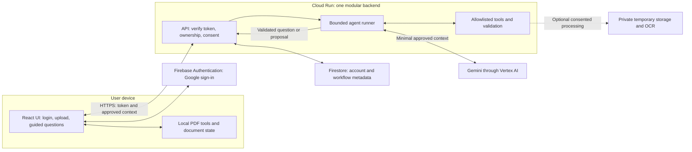

# Frontend-to-backend architecture: discussion draft

This is a proposed architecture, not deployed infrastructure. Only the login-screen preview currently exists.

## Keep the first version understandable

Start with a React frontend and one Node.js/TypeScript backend on Cloud Run, internally separated into authentication, document sessions, agent orchestration and tools. Separate deployment units only when measured workloads or security boundaries justify them. Native apps can use the same API later.

## Main boundaries

| Layer | Owns | Must not own |
| --- | --- | --- |
| React | Accessible UI, local preview, form input and explicit approval UX | Secrets or final authorization decisions |
| API | Token verification, user isolation, consent scope, input validation, rate limits | Trust in client-supplied user IDs |
| Agent runner | Selecting allowed next actions, context selection, bounded model/tool loop | Unrestricted document changes or external submission |
| Tools | Deterministic extraction, format validation and permitted PDF operations | Letting model instructions override approvals |
| Persistence | Minimal account/workflow metadata and later export entitlements | Default permanent storage of forms, signatures or answer text |

## Request lifecycle

1. Firebase Authentication performs Google sign-in; client observes auth state.
2. Client sends a Firebase ID token in the Authorization header over HTTPS. Backend verifies signature, expiry, issuer and audience; it derives the user ID from the verified token.
3. User selects a file. Client checks size/type for UX; any server upload independently validates and safely parses the actual content. Preview/extraction stay local where feasible.
4. The document session tracks local bytes separately from server metadata. Creating metadata is not consent to transfer document contents.
5. User reviews the exact content to be shared. Backend records a scoped consent revision and enforces that scope on subsequent requests.
6. The agent receives only approved context and suggests a next question or tool call. Backend validates known field IDs, schemas, state revision, ownership and approval requirements before accepting any action.
7. API returns a typed next-action response. React renders an accessible question or approval panel and announces status.
8. On retries, request IDs and state revisions prevent duplicate or stale changes. Cancellation, timeouts and model errors offer a clear resume or manual path.

## Initial API sketch

- POST /v1/document-sessions: create metadata for a locally selected document.
- PUT /v1/document-sessions/:id/consent: grant or revoke explicit external-processing scopes.
- POST /v1/document-sessions/:id/turns: submit an answer or request the next step, with approved context and expected state revision.
- POST /v1/document-sessions/:id/approvals: approve a specific proposed action tied to a document revision.
- DELETE /v1/document-sessions/:id: remove server session data and any associated temporary objects, with a clear result.

Every session endpoint checks ownership. Do not place sensitive values in URLs. Initially use ordinary request/response JSON. Add server-sent events for useful progress updates only when needed; WebSockets are not required. Provider callbacks or internal queues may later support lengthy OCR. Payment webhooks are a later server-side integration.

## Decisions still to validate

- Which document operations work locally on low-memory mobile browsers? Benchmark realistic forms before promising local-only OCR.
- What does resuming on a second device mean? No default server retention means cross-device document recovery is not automatic.
- Which regions, data-handling settings and deletion behavior meet target users' needs?
- Which model meets field-explanation accuracy and latency/cost targets on our evaluation set?
- What peak concurrency and processing volume should support the 1–2 million registered-account ambition?

## Explore in VS Code

For drag-and-drop editing, install Draw.io Integration (hediet.vscode-drawio) and open system.drawio. It uses a local editor by default. For text-based diagrams, install the Mermaid extension (mermaidchart.vscode-mermaid-chart), open system.mmd and use its preview. These are complementary snapshots; changing one format does not automatically update the other.

Extension documentation:
- https://marketplace.visualstudio.com/items?itemName=hediet.vscode-drawio
- https://marketplace.visualstudio.com/items?itemName=mermaidchart.vscode-mermaid-chart
